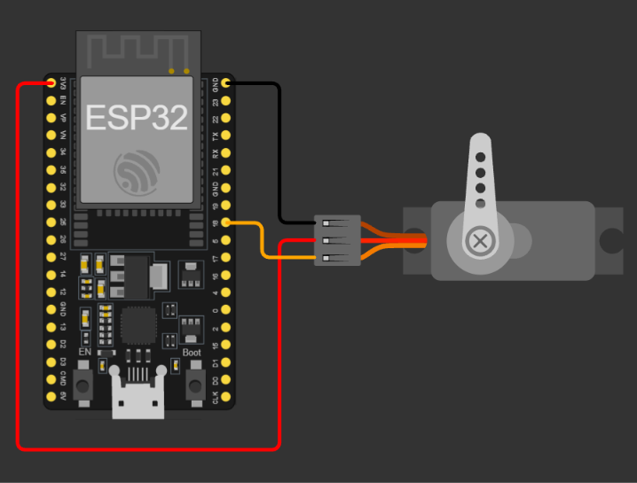

# Real-Time Hand Tracking Servo Motor Control

This project tracks hand movements from a tablet's live camera feed. The calculated joint angle is transmitted to an ESP microcontroller via UDP over the local network to control a servo motor in real time.

## Technologies Used

* **Frontend:** HTML5, CSS3, JavaScript (MediaDevices API, Canvas API, WebSocket Client)
* **Backend:** Python, `websockets`, OpenCV (`cv2`), NumPy, Google MediaPipe
* **Hardware & Communication:** ESP32, C++ (Arduino), WiFiUDP, Servo Motor

---

## Implementation Steps

1. **Frame Capture (Frontend):** The tablet camera captures the video feed, converts frames to lightweight JPEG blobs using a hidden Canvas, and streams them to the server over a WebSocket connection.
2. **Image Decoding (Backend):** The Python server receives the bytes and decodes them directly in RAM into an OpenCV image matrix.
3. **Hand Tracking:** MediaPipe identifies hand landmarks and extracts their 2D coordinates.
4. **Angle Calculation:** Target joint coordinates are used to calculate the relative angle, mapped to standard servo ranges (0–180°).
5. **Data Transmission (UDP):** The computed angle is dispatched to the ESP's local IP address via UDP for near-zero latency.
6. **Actuation (Hardware):** The ESP board parses the incoming UDP packet and sets the servo motor to the target position.

---

## Circuit Diagram

  
*Circuit diagram was created using Wokwi.*

---

## Hardware & Safety Warning

>CAUTION : Disconnect the ESP32 from power before changing the circuit. Do not connect the circuit directly to mains electricity.